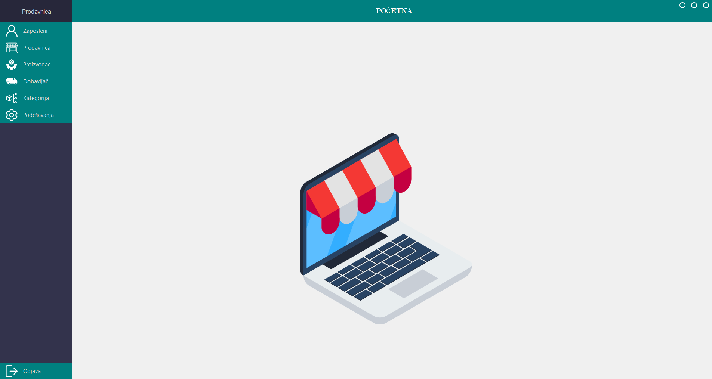

<div align="center">

# 🖥️ Store Management System


<picture>
    <source srcset="readme_assets/demo.gif" type="image/gif">
    
</picture>

</div>

---

## 📌 Project Overview

**Store Management System** is a desktop application for managing retail store operations with role-based access for administrators and cashiers. Features full CRUD operations for users and inventory, password hashing, and audit logging of all operations.

---

## ✨ Features

### 👤 Administrator
- Manage users — add, update, delete, and view all accounts
- Manage full product inventory with categories, pricing, and stock
- View audit logs of all operations
- Manage suppliers and purchases

### 🛒 Cashier
- Browse and search product inventory
- Process sales and generate receipts
- View and filter products by category, price, and availability

### 🔒 Security
- BCrypt password hashing for all user accounts
- Role-based access control — administrators and cashiers have separate panels

---

## 🛠️ Tech Stack

| Technology | Usage |
|------------|-------|
| C# / .NET | Core application language and framework |
| WinForms | Desktop GUI |
| MySQL | Relational database for users and inventory |
| Docker | MySQL containerization |
| BCrypt | Password hashing |

---

## 🚀 Setup & Run

### Prerequisites
- .NET 7+ SDK
- Docker and Docker Compose

### 1. Clone the repository
```bash
git clone https://github.com/pero-grubac/Store-Management-System.git
cd Store-Management-System
```

### 2. Start the database
```bash
docker compose up -d
```

MySQL will automatically initialize with the schema from `Model/DDL.sql`.

### 3. Configure connection string

Copy `Util/appsettings.example.json` to `Util/appsettings.json` and update if needed:
```json
{
  "ConnectionStrings": {
    "DefaultConnection": "Server=localhost; Port=3306; Database=prodavnica; User Id=root; Password=root"
  }
}
```


### Default credentials

| Role | Username | Password |
|------|----------|----------|
| Administrator | admin | admin123 |

---

## 📂 Project Structure

```
Store-Management-System/
├── Model/              # Database models and DDL.sql
├── Prodavnica/         # Main project
│   ├── Database/       # Repository pattern and DAO implementations
│   ├── Forms/          # WinForms UI screens
│   ├── Language/       # Localization files
│   ├── Resources/      # Images and assets
│   └── Util/           # DBUtil, appsettings.json
├── readme_assets/      # README images and GIF
├── docker-compose.yml
└── README.md
```