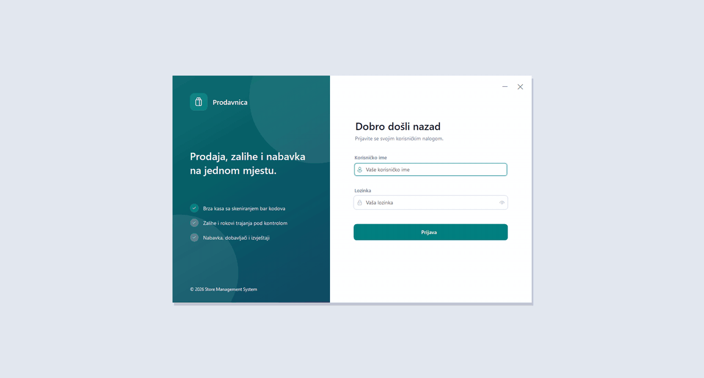
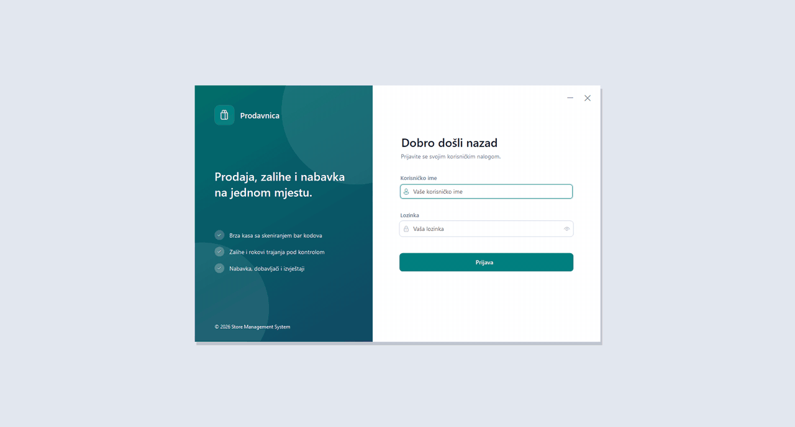
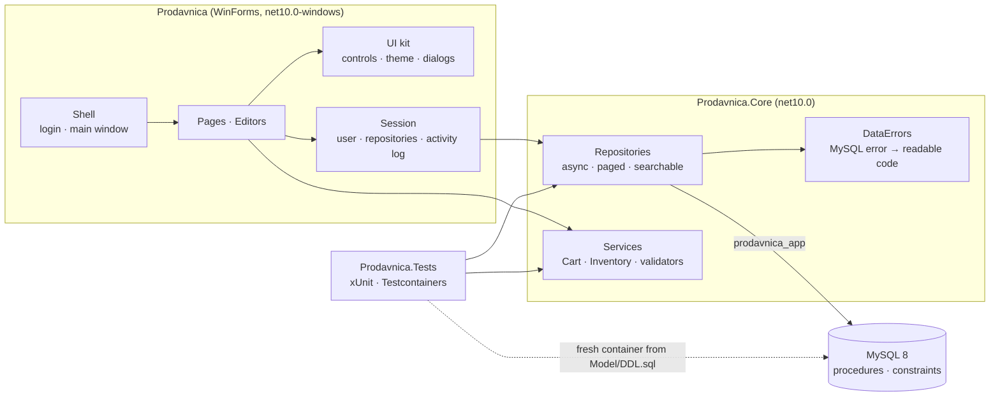
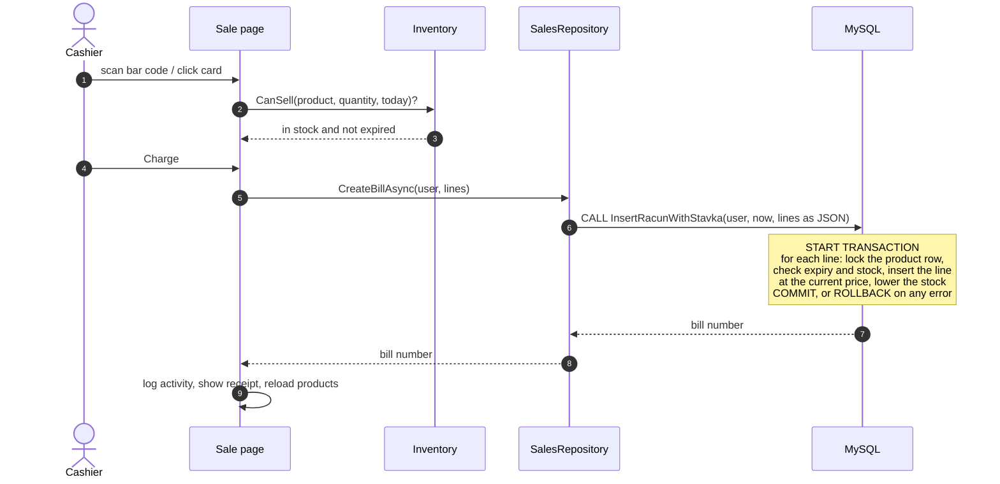
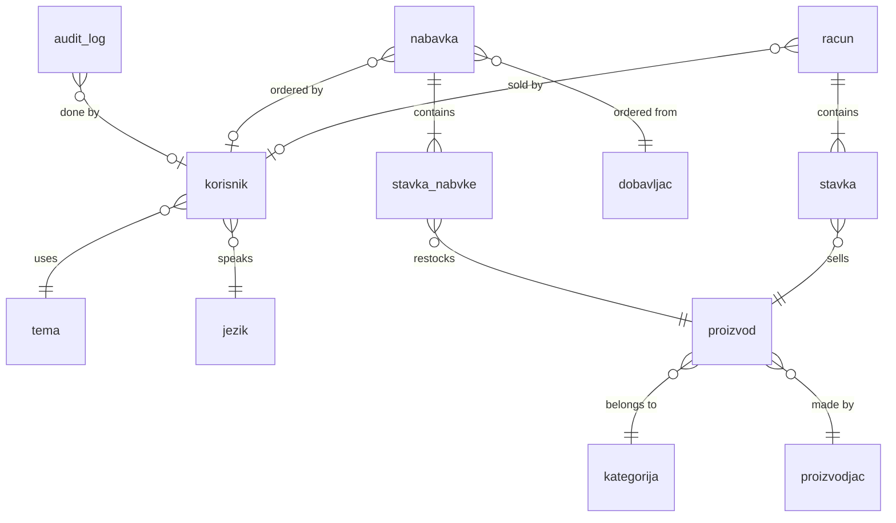

<div align="center">

# 🛒 Store Management System

[](https://github.com/pero-grubac/Store-Management-System/actions/workflows/ci.yml)


**A desktop point-of-sale and inventory app for a small shop: a till with bar code scanning, stock and expiry tracking, purchasing, staff accounts and an activity log.**

<table>
  <tr>
    <th>🛡️ Administrator</th>
    <th>🧾 Cashier</th>
  </tr>
  <tr>
    <td></td>
    <td></td>
  </tr>
</table>

</div>

---

## 📌 Project Overview

**Store Management System** is a Windows desktop application, first built for the *Human–Computer Interaction* course and since rebuilt with a modern interface, a tested data layer and CI. Each role sees only what their job needs:

| Role | Demo account | What they can do |
|------|--------------|------------------|
| 🛡️ **Administrator** | `admin` / `admin123` | Everything a cashier can, plus products, procurement, staff, manufacturers, suppliers, categories and the activity log |
| 🧾 **Cashier** | `kasir` / `kasir123` | Sell at the till, browse products, see bills, print receipts |

Every account has its own picture, accent colour, font size and language (Serbian Latin, Serbian Cyrillic, English). The other 20 demo staff accounts use the password `lozinka123`.

---

## ✨ Features

- 📊 **Dashboard**: today's sales, stock value, low stock and expiry counts, a 14-day sales chart, the latest bills and a *Needs attention* list
- 🧾 **Till**: scan or type a bar code, or click product cards; change quantities with steppers (decimals for goods sold by weight); charge, then print the receipt
- 🗂️ **Products** as picture cards or as a table, with live search, a category filter and paging; double-click to edit
- 🚚 **Procurement** from a supplier at purchase prices, pre-filled with the last price paid
- 📅 **Bills and procurements** by date range (today, 7, 30, 90 days or any range), with details and printing
- 👥 **Staff** with pictures, roles and passwords; you cannot delete yourself or the last administrator
- 🏭 **Manufacturers, suppliers and categories**, each with usage counts
- 🕑 **Activity log**: sign-ins, sales, procurements and every change, searchable
- 🎨 **Appearance**: accent colour, font and text size per user, applied instantly
- 🔐 **Safety**: BCrypt passwords, a restricted database account, sales and procurements in transactions, stock that can never go below zero

### 🚦 Stock and expiry rules

| Badge | Rule |
|-------|------|
| 🟢 *N in stock* | 10 or more |
| 🟠 *Only N left* | More than 0, fewer than 10 |
| 🔴 *Out of stock* | 0, not offered at the till |
| 🟠 *Expires soon* | Best before within 30 days |
| 🔴 *Expired* | Past its best-before date; the till and the database both refuse to sell it |

---

## 🛠️ Tech Stack

| Technology | Usage |
|------------|-------|
| .NET 10, C# | Application and class library |
| Windows Forms | Desktop UI, built in code with custom-drawn controls (no designer files) |
| MySQL 8 | Data, transactional stored procedures, CHECK constraints |
| MySqlConnector | Async database driver |
| BCrypt.Net-Next | Password hashing |
| Docker Compose | Local database, created from `Model/DDL.sql` |
| xUnit + Testcontainers | Unit tests and integration tests against a real MySQL |
| GitHub Actions | CI, vulnerability check, release builds |

---

## 📁 Repository Structure

```
Store-Management-System/
├── Prodavnica/                 WinForms app
│   ├── App/                    Session: signed-in user, repositories, activity logging
│   ├── Shell/                  Login window and main window (sidebar, header, page host)
│   ├── Pages/                  Dashboard, till, products, procurement, documents, admin lists, settings
│   ├── Editors/                Product, employee, name/e-mail and document dialogs
│   ├── UI/                     Theme, drawing helpers, dialogs, toasts
│   │   └── Controls/           Buttons, inputs, selects, dates, tables, pager, cards, chart, image picker
│   └── Language/               .resx translations: sr (Latin), sr-Cyrl-RS, en
├── Prodavnica.Core/            Class library with no UI dependency
│   ├── Database/               DTOs, async repositories, paging, database error translation
│   ├── Security/               Password hashing
│   └── Services/               Cart, Inventory, validators, totals, theme and language helpers
├── Prodavnica.Tests/           xUnit: Unit/ and Database/ (Testcontainers)
├── Model/                      DDL.sql (schema, procedures, app account, demo data) and the Workbench model
├── docker-compose.yml          Local MySQL 8
├── .github/workflows/ci.yml    CI/CD
└── Korisničko uputstvo.pdf     Original user manual (Serbian)
```

---

## 🚀 Installation

### Prerequisites

- Windows 10 or 11
- [.NET 10 SDK](https://dotnet.microsoft.com/download/dotnet/10.0)
- [Docker Desktop](https://www.docker.com/products/docker-desktop/) (for the database and the integration tests)
- Optional: Visual Studio 2022 17.14+ or JetBrains Rider

### 1. Clone the repository

```bash
git clone https://github.com/pero-grubac/Store-Management-System.git
cd Store-Management-System
```

### 2. Start the database

```bash
docker compose up -d
```

MySQL listens on `localhost:3306`. On the first start it runs [`Model/DDL.sql`](Model/DDL.sql): tables, the two stored procedures, the `prodavnica_app` account and demo data (22 staff, 120 products in 10 categories, about 560 bills over the last 90 days, 45 procurements). Dates in the demo data are relative to the day the database is created.

### 3. Configure the connection

```bash
copy Prodavnica\Util\appsettings.example.json Prodavnica\Util\appsettings.json
```

```json
{
  "ConnectionStrings": {
    "DefaultConnection": "Server=localhost; Port=3306; Database=prodavnica; User Id=prodavnica_app; Password=prodavnica_app"
  }
}
```

The app connects with `prodavnica_app`, which can read and write data and call the procedures but cannot change the schema. Change its password outside a local demo. `appsettings.json` is git-ignored; the `STORE_DB_CONNECTION` environment variable overrides it.

### 4. Run

```bash
dotnet run --project Prodavnica
```

Or open `Prodavnica.sln` and start the **Prodavnica** project. Sign in with one of the [demo accounts](#-project-overview).

### Start over with fresh data

```bash
docker compose down -v
docker compose up -d
```

### Download a build

Every tagged version (`v*`) is published on the [Releases](https://github.com/pero-grubac/Store-Management-System/releases) page as a self-contained `win-x64` zip. It needs no .NET installation, only the database and `Util/appsettings.json` next to the executable.

---

## 🧭 Usage

The main window opens maximized (the taskbar stays visible) and can be resized or minimized like any window. The sidebar lists the sections of your role; the bottom of it shows who is signed in.

### At the till (cashier and administrator)

1. Open **Sale**. The bar code field has focus: scan a product (scanners type the code and press Enter) or type the code yourself.
2. Or click product cards; search and the category filter narrow the list. Only products in stock and not expired are shown.
3. In the bill on the right, use **–** and **+** or type a quantity (`0,5` for half a kilo). A quantity above the stock turns red and **Charge** is disabled.
4. **Charge** saves the bill in one transaction, lowers the stock and opens the receipt; **Print** shows a print preview.

### Managing the store (administrator)

- **Products**: **New product**, or double-click a card or row to edit. Fields are checked as you type and on save (unique digits-only bar code, positive price, non-negative stock). Right-click for **Edit** and **Delete**; a product that has been sold cannot be deleted.
- **Procurement**: choose the supplier, click the products, set quantity and purchase price (pre-filled with the last price paid), **Confirm order**.
- **Bills and procurements**: switch between sales and procurements, pick a range, search by number, cashier or supplier, double-click for details.
- **Employees, Manufacturers, Suppliers, Categories**: search, page, double-click to edit, right-click to delete.
- **Activity**: who signed in, sold, bought or changed what, and when.

### Settings (everyone)

Profile with picture, password change (the current password is required), accent colour, font, text size and language. Appearance and language apply immediately.

---

## 🏗️ Architecture

The UI talks only to `Prodavnica.Core`, which holds data access and rules and has no WinForms reference, so its tests run on Linux in CI. All database calls are asynchronous, so the window never freezes while a query runs.



### How a sale is saved



Procurement works the same way through `InsertNabavka`, which raises the stock. Errors raised in the procedures (`INSUFFICIENT_STOCK`, `PRODUCT_EXPIRED`) and constraint violations (duplicates, products still in use, negative stock) reach the user as translated messages.

### Data model



---

## 🧭 Design Decisions

- **A UI-free core.** Data access and rules live in `Prodavnica.Core`, so they are tested without a screen and the forms stay thin.
- **The database guards its own data.** Transactions with row locks, `CHECK (Zalihe >= 0)` and unique keys stop overselling and duplicates even if two tills sell at once.
- **Least privilege.** The app signs in as `prodavnica_app` (data and procedures only); an integration test proves it cannot drop tables.
- **Paging and search in SQL.** Lists ask the database for one page at a time, so they stay fast with thousands of bills.
- **One look, built in code.** A small set of custom-drawn controls (buttons, inputs, selects, tables, cards) replaces the designer forms; the user's colour is used only as an accent so any choice stays readable.
- **Readable errors.** MySQL error numbers and procedure signals become stable codes (`IN_USE`, `INSUFFICIENT_STOCK`…) that the UI translates.
- **Real database in tests.** Integration tests start MySQL 8 with Testcontainers and load the same `DDL.sql` as Docker Compose.

---

## 🧪 Tests

```bash
dotnet test Prodavnica.Tests                                   # everything (needs Docker)
dotnet test Prodavnica.Tests --filter "Category!=Integration"  # unit tests only, no Docker
```

| Suite | Tests | Covers |
|-------|------:|--------|
| Unit | 90 | Cart, stock and expiry rules, product and staff validation (two cultures), paging and search patterns, password hashing, theme colours, language mapping |
| Integration | 30 | Paging, search and filters, product CRUD with pictures, unique and in-use protection, negative stock rejected, sales at database prices with rollback on insufficient stock or expiry, procurement, sign-in, staff rules, reference data, activity log, the dashboard, the restricted app account |

---

## ⚙️ CI/CD

[`.github/workflows/ci.yml`](.github/workflows/ci.yml) runs on pushes and pull requests to `master`:

| Job | Runner | Does |
|-----|--------|------|
| **Tests** | Ubuntu | Builds Core and the tests, runs unit and integration tests (MySQL via Testcontainers), uploads results and coverage |
| **Desktop build** | Windows | Builds the whole solution and fails on NuGet packages with known vulnerabilities |
| **Release** | Windows | Only for tags `v*`: publishes a self-contained single-file `win-x64` build and attaches the zip to a GitHub release |

CI **does not start** for Markdown, `readme_assets/`, images, the user manual (`.pdf`, `.docx`), the Workbench model, the license, `.gitignore` or `.gitattributes`. A newer push to the same branch cancels the older run.

```bash
git tag v2.0.0
git push origin v2.0.0
```

---

## 📄 License

[MIT](LICENSE.txt) © Pero Grubač
